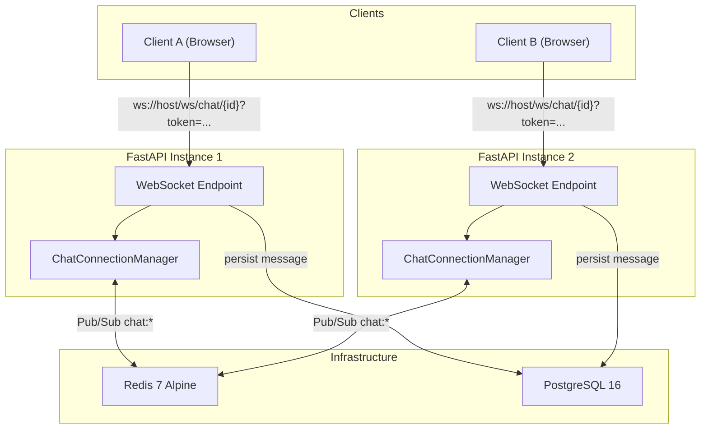
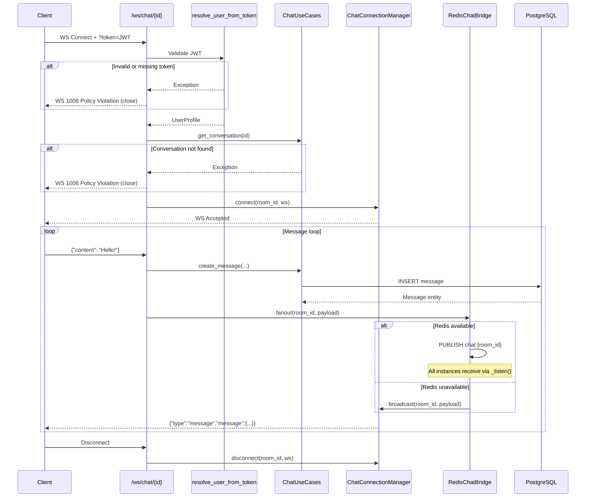
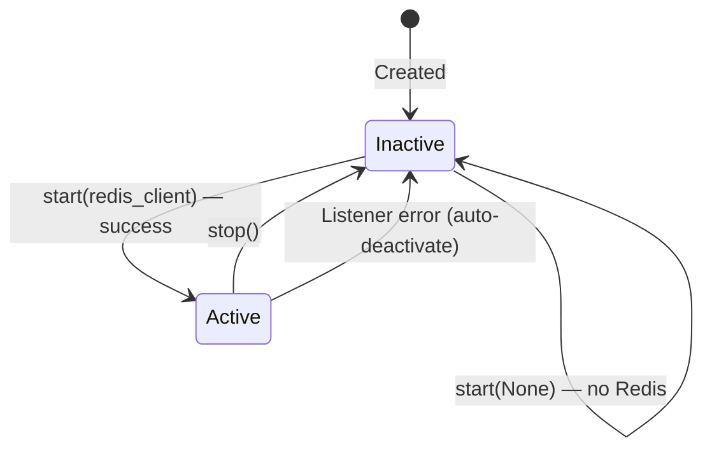
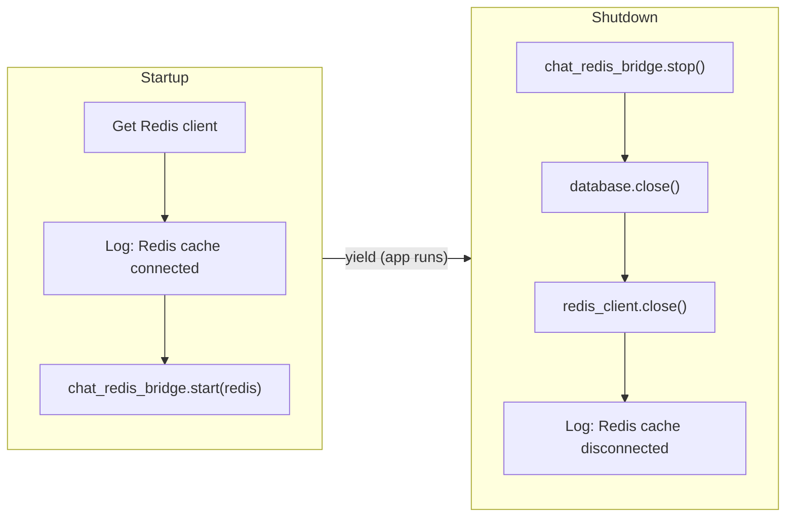

# WebSockets & Redis Pub/Sub — Technical Documentation

## Table of Contents

1. [Architecture Overview](#architecture-overview)  
2. [WebSocket Layer](#websocket-layer)  
3. [Redis Pub/Sub Bridge](#redis-pubsub-bridge)  
4. [Redis Caching Layer](#redis-caching-layer)  
5. [Configuration & Infrastructure](#configuration--infrastructure)  
6. [Message Flow (End-to-End)](#message-flow-end-to-end)  
7. [File Reference](#file-reference)  

---

## Architecture Overview

The Mano backend implements a **real-time chat system** using FastAPI WebSockets with an optional **Redis Pub/Sub fanout bridge** for horizontal scaling. Redis also serves as a **general-purpose cache** via a clean domain interface.



### Design Decisions

| Decision | Rationale |
|---|---|
| **Redis fanout is optional** | The bridge gracefully degrades — if Redis is unavailable, messages are broadcast locally only. This makes development and testing simpler. |
| **Singleton Redis client** | A single `RedisClient` class manages the connection pool, reused by both caching and Pub/Sub. |
| **Token via query param** | WebSockets don't support standard `Authorization` headers, so the JWT is passed as `?token=` on the connection URL. |
| **Room-scoped Redis subscriptions** | Each FastAPI instance subscribes only to conversation channels that currently have local websocket listeners. This avoids global `chat:*` fanout overhead. |

---

## WebSocket Layer

### ChatConnectionManager

**File:** [chat.py](file:///home/egz-user/mano/backend/src/mano/presentation/websockets/chat.py#L14-L47)

An in-memory registry that tracks active WebSocket connections grouped by `conversation_id` (room). All operations are protected by an `asyncio.Lock` for thread safety.

| Method | Signature | Description |
|---|---|---|
| `connect` | `(conversation_id, websocket) → None` | Accepts the WebSocket handshake and registers it in the room map. |
| `disconnect` | `(conversation_id, websocket) → None` | Removes a socket from its room; cleans up the room key if empty. |
| `broadcast` | `(conversation_id, payload) → None` | Sends a JSON payload to **all** connections in a room. Stale connections that throw on send are automatically cleaned up. |

```python
# Internal state
_connections: dict[str, list[WebSocket]]  # conversation_id → [ws1, ws2, ...]
_lock: asyncio.Lock
```

> [!NOTE]
> `broadcast` acquires the lock only to **snapshot** the recipient list, then releases it before sending. This avoids holding the lock during I/O.

### WebSocket Endpoint

**File:** [chat_ws.py](file:///home/egz-user/mano/backend/src/mano/presentation/api/chat_ws.py)

**Route:** `ws://host/ws/chat/{conversation_id}?token=<JWT>`

#### Connection Lifecycle



#### Authentication Flow

1. Extract `token` from `websocket.query_params`
2. If missing → close with `WS_1008_POLICY_VIOLATION`
3. Create auth + user repositories via `InfrastructureServiceFactory`
4. Call [resolve_user_from_token](file:///home/egz-user/mano/backend/src/mano/dependencies.py#L233-L287) to decode JWT and resolve/create user
5. Verify the conversation exists
6. On any failure → close with `WS_1008_POLICY_VIOLATION`

#### Inbound Message Handling

| Step | Action |
|---|---|
| 1 | Receive JSON payload via `websocket.receive_json()` |
| 2 | Validate `content` field is a non-empty string |
| 3 | Create message through `ChatService.create_message()` |
| 4 | Commit DB transaction on success |
| 5 | Serialize via `ChatSocketMessageSchema` |
| 6 | Fan out via `chat_redis_bridge.fanout()` |

#### Error Responses (in-band)

```json
{"type": "error", "detail": "Payload must include string field 'content'"}
{"type": "error", "detail": "Conversation not found: ..."}
{"type": "error", "detail": "Message content cannot be empty"}
```

### Schemas

**File:** [chat_schemas.py](file:///home/egz-user/mano/backend/src/mano/presentation/schemas/chat_schemas.py)

#### `ChatSocketMessageSchema` (outbound envelope)

```json
{
  "type": "message",
  "message": {
    "id": "uuid",
    "conversation_id": "uuid",
    "sender_id": "uuid",
    "content": "Hello!",
    "created_at": "2026-04-22T19:00:00Z"
  }
}
```

#### `ChatMessageCreateSchema` (inbound — HTTP & WS)

```json
{
  "content": "Hello!"   // min 1 char, max 4000 chars
}
```

---

## Redis Pub/Sub Bridge

### RedisChatBridge

**File:** [chat.py](file:///home/egz-user/mano/backend/src/mano/presentation/websockets/chat.py#L49-L131)

An optional layer that uses Redis Pub/Sub to distribute WebSocket messages across **multiple FastAPI instances**. Without it, each process can only broadcast to its own local connections.

#### Channel Naming

```
chat:{conversation_id}
```

Each bridge subscribes only to the `chat:{conversation_id}` channels that currently have local websocket consumers.

#### Envelope Format (Redis)

The bridge wraps the outbound payload with `conversation_id` for routing:

```json
{
  "type": "message",
  "message": { "id": "...", "content": "...", ... },
  "conversation_id": "abc-123"
}
```

On the receiving side, `conversation_id` is stripped before broadcasting to local WebSocket clients.

#### Lifecycle



| Method | Description |
|---|---|
| `start(redis_client)` | Initializes Pub/Sub and spawns `_listen()` as a background task. Existing active rooms are subscribed if Redis is available. |
| `stop()` | Cancels the listener task, closes the Pub/Sub subscription. |
| `fanout(conversation_id, payload)` | If active: publishes to `chat:{conversation_id}`. If inactive: falls back to local `ChatConnectionManager.broadcast()`. |
| `_listen()` | Infinite loop polling `get_message()`. Deserializes JSON, routes by `conversation_id`, broadcasts locally. Auto-deactivates on unexpected errors. |

#### Graceful Degradation

```python
async def fanout(self, conversation_id, payload):
    if self._active and self._redis_client is not None:
        try:
            await self._redis_client.publish(f"chat:{conversation_id}", json.dumps(envelope))
            return
        except Exception:
            logger.warning("Redis chat publish failed: %s", exc)
    # Fallback: local broadcast only
    await self._manager.broadcast(conversation_id, payload)
```

> [!IMPORTANT]
> The bridge **never raises** on Redis failure. If `publish` fails, it silently falls back to local delivery and logs a warning.

---

## Redis Caching Layer

### CacheInterface (Domain Port)

**File:** [cache_interface.py](file:///home/egz-user/mano/backend/src/mano/domain/repositories/cache_interface.py)

Abstract base class defining the caching contract. This keeps the domain layer independent of Redis.

| Method | Signature | Description |
|---|---|---|
| `get` | `(key) → Any \| None` | Retrieve a cached value |
| `set` | `(key, value, ttl?) → None` | Store a value with optional TTL (seconds) |
| `delete` | `(key) → None` | Remove a cached entry |
| `exists` | `(key) → bool` | Check key existence |
| `clear_pattern` | `(pattern) → None` | Delete all keys matching a glob pattern |
| `close` | `() → None` | Close the cache connection |

### RedisCache (Infrastructure Adapter)

**File:** [redis_cache.py](file:///home/egz-user/mano/backend/src/mano/infrastructure/cache/redis_cache.py)

Implements `CacheInterface` using `redis.asyncio`. Key behaviors:

- **Serialization:** `dict`/`list` values → JSON; everything else → `str()`
- **Deserialization:** Attempts `json.loads()`, falls back to raw string
- **Graceful degradation:** Every method catches all exceptions and returns safe defaults (`None`, `False`, no-op). Redis being down never crashes the application.

### RedisClient Singleton

**File:** [connection.py](file:///home/egz-user/mano/backend/src/mano/infrastructure/cache/connection.py)

| Method | Description |
|---|---|
| `get_client()` | Lazily creates an `aioredis.Redis` instance from the configured URL. Returns the cached instance on subsequent calls. |
| `close()` | Gracefully closes the connection and resets the singleton. |

```python
# Connection parameters
aioredis.from_url(
    settings.redis.url,     # redis://localhost:6379/0
    encoding="utf-8",
    decode_responses=True,  # returns str instead of bytes
)
```

A FastAPI dependency `get_redis_client()` wraps the singleton for use in route handlers.

---

## Configuration & Infrastructure

### Redis Settings

**File:** [settings.py](file:///home/egz-user/mano/backend/src/mano/infrastructure/config/settings.py#L41-L62)

| Env Variable | Default | Description |
|---|---|---|
| `REDIS_HOST` | `localhost` | Redis server hostname |
| `REDIS_PORT` | `6379` | Redis server port |
| `REDIS_DB` | `0` | Redis database number |
| `REDIS_PASSWORD` | `None` | Redis auth password (optional) |

Generated URL format:
```
redis://[:password@]host:port/db
```

### Docker Compose

**File:** [docker-compose.yml](file:///home/egz-user/mano/docker-compose.yml#L25-L36)

```yaml
redis:
  image: redis:7-alpine
  container_name: mano_redis
  ports:
    - "6379:6379"
  volumes:
    - redis_data:/data
  healthcheck:
    test: ["CMD", "redis-cli", "ping"]
    interval: 10s
    timeout: 5s
    retries: 5
```

The `app` service depends on `redis` with `condition: service_healthy`, ensuring Redis is ready before the FastAPI application starts.

### Application Lifespan

**File:** [main.py](file:///home/egz-user/mano/backend/src/mano/main.py#L105-L125)



> [!TIP]
> If Redis is unavailable at startup, the lifespan handler catches the exception, logs a warning, and the app continues running with local-only WebSocket delivery and no caching.

---

## Message Flow (End-to-End)

### Single Instance (No Redis)

```
Client A sends {"content": "Hello"}
    → WS Endpoint validates & persists to DB
    → ChatConnectionManager.broadcast(room, payload)
    → Client A receives {"type":"message","message":{...}}
    → Client B receives {"type":"message","message":{...}}
```

### Multi-Instance (With Redis)

```
Client A (Instance 1) sends {"content": "Hello"}
    → WS Endpoint validates & persists to DB
    → RedisChatBridge.fanout(room, payload)
        → PUBLISH chat:room-123  {"type":"message","message":{...},"conversation_id":"room-123"}
    
Instance 1 _listen() receives message:
    → strips conversation_id
    → ChatConnectionManager.broadcast(room, payload)
    → Client A receives the message

Instance 2 _listen() receives message:
    → strips conversation_id
    → ChatConnectionManager.broadcast(room, payload)
    → Client B receives the message
```

---

## File Reference

| File | Layer | Purpose |
|---|---|---|
| [chat.py](file:///home/egz-user/mano/backend/src/mano/presentation/websockets/chat.py) | Presentation | `ChatConnectionManager` + `RedisChatBridge` |
| [chat_ws.py](file:///home/egz-user/mano/backend/src/mano/presentation/api/chat_ws.py) | Presentation | WebSocket endpoint `/ws/chat/{id}` |
| [chat_schemas.py](file:///home/egz-user/mano/backend/src/mano/presentation/schemas/chat_schemas.py) | Presentation | Pydantic schemas for WS payloads |
| [cache_interface.py](file:///home/egz-user/mano/backend/src/mano/domain/repositories/cache_interface.py) | Domain | Abstract `CacheInterface` port |
| [redis_cache.py](file:///home/egz-user/mano/backend/src/mano/infrastructure/cache/redis_cache.py) | Infrastructure | `RedisCache` adapter implementing `CacheInterface` |
| [connection.py](file:///home/egz-user/mano/backend/src/mano/infrastructure/cache/connection.py) | Infrastructure | `RedisClient` singleton + FastAPI dependency |
| [settings.py](file:///home/egz-user/mano/backend/src/mano/infrastructure/config/settings.py) | Infrastructure | `RedisSettings` configuration |
| [main.py](file:///home/egz-user/mano/backend/src/mano/main.py) | Application | Lifespan hooks — Redis + bridge init/shutdown |
| [dependencies.py](file:///home/egz-user/mano/backend/src/mano/dependencies.py) | Application | `get_redis_client` + `resolve_user_from_token` |
| [message.py](file:///home/egz-user/mano/backend/src/mano/domain/models/message.py) | Domain | `Message` entity (max 4000 chars, auto-trimmed) |
| [conversation.py](file:///home/egz-user/mano/backend/src/mano/domain/models/conversation.py) | Domain | `Conversation` aggregate root |
| [docker-compose.yml](file:///home/egz-user/mano/docker-compose.yml) | DevOps | Redis 7 Alpine container definition |
